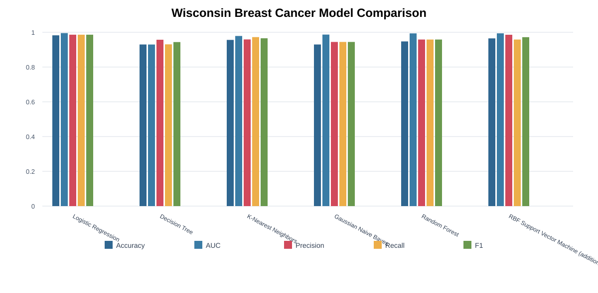
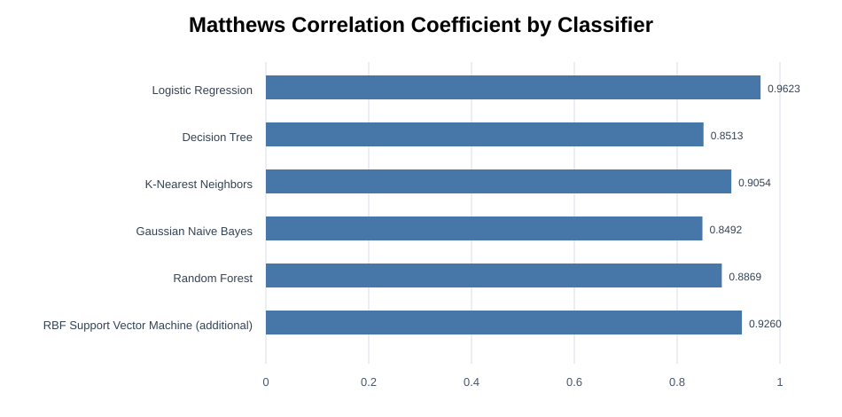
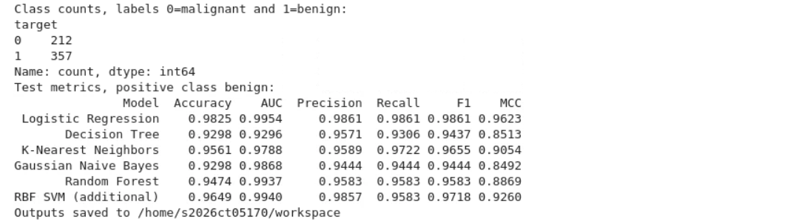

# Classification Model Comparison for Breast Cancer Diagnosis

## Problem statement
This assignment compares classifiers that predict whether a breast mass is malignant or benign. It uses the Wisconsin Diagnostic Breast Cancer dataset. The instructions require five classifiers, while the results table asks for six, so an RBF Support Vector Machine is included as an extra model.

## Dataset description
The dataset has 569 cases and 30 numeric measurements taken from digitized fine needle aspirate images. The target column is `target`: `0` means malignant and `1` means benign. It contains 212 malignant cases (37.3%) and 357 benign cases (62.7%). All input features are numeric, so categorical encoding is not needed. The dataset source is the [UCI Machine Learning Repository](https://archive.ics.uci.edu/dataset/17/breast+cancer+wisconsin+diagnostic). This run used the version included with scikit-learn.

## GitHub Repository Link
[https://github.com/2026ct05170-pixel/ml-assignment2](https://github.com/2026ct05170-pixel/ml-assignment2)

## Preprocessing
There were no missing values or duplicate rows in the data. The code checks for duplicates and includes a median imputer in each model pipeline. I split the data into 80% for training and 20% for testing, keeping the class proportions similar in both parts (`random_state=42`). Logistic Regression, KNN, Gaussian Naive Bayes, and SVM use scaling; the tree models do not. The preprocessing is fitted using training data only. Benign (label 1) is treated as the positive class for Precision, Recall, F1, and AUC. I also need to consider malignant-class recall, since missing a malignant case matters.

## Models used and results
I evaluated all models on the same held-out test split in the BITS Virtual Lab. Scores are rounded to four decimal places. The results are below.

| Model | Accuracy | AUC | Precision | Recall | F1 | MCC |
|---|---:|---:|---:|---:|---:|---:|
| Logistic Regression | 0.9825 | 0.9954 | 0.9861 | 0.9861 | 0.9861 | 0.9623 |
| Decision Tree | 0.9298 | 0.9296 | 0.9571 | 0.9306 | 0.9437 | 0.8513 |
| K-Nearest Neighbors | 0.9561 | 0.9788 | 0.9589 | 0.9722 | 0.9655 | 0.9054 |
| Gaussian Naive Bayes | 0.9298 | 0.9868 | 0.9444 | 0.9444 | 0.9444 | 0.8492 |
| Random Forest | 0.9474 | 0.9937 | 0.9583 | 0.9583 | 0.9583 | 0.8869 |
| RBF Support Vector Machine (additional) | 0.9649 | 0.9940 | 0.9857 | 0.9583 | 0.9718 | 0.9260 |

### Observations
| ML Model Name | Observation about model performance |
|---|---|
| Logistic Regression | It had the strongest overall results: 0.9825 accuracy, 0.9954 AUC, 0.9861 F1, and 0.9623 MCC. |
| Decision Tree | It reached 0.9298 accuracy and 0.9437 F1. Its MCC was 0.8513, among the lowest scores. |
| kNN | It achieved 0.9561 accuracy and the highest recall for benign cases (0.9722). Its MCC was 0.9054. |
| Naive Bayes | Its accuracy was 0.9298 and AUC was 0.9868. Its MCC (0.8492) was the lowest among the models. |
| Random Forest (Ensemble) | It achieved 0.9474 accuracy and a high AUC of 0.9937. Its MCC was 0.8869. |
| **Overall Winner for this dataset** | **Logistic Regression**, based on its highest accuracy, AUC, F1, and MCC on this test split. |

These results are from one split. Repeated cross-validation could provide a more reliable comparison. The additional RBF SVM is included in the metrics table above; its accuracy was 0.9649 and MCC was 0.9260.

## Model configurations and execution

| Model | Configuration |
|---|---|
| Logistic Regression | Standard scaling, max_iter=5000, seed=42 |
| Decision Tree | Balanced class weights, seed=42 |
| K-Nearest Neighbors | k=5, standard scaling |
| Gaussian Naive Bayes | Standard scaling |
| Random Forest | 300 trees, balanced class weights, seed=42 |
| RBF Support Vector Machine (additional) | RBF kernel, balanced class weights, standard scaling, seed=42 |

In the project directory, install dependencies with `python -m pip install -r requirements.txt`, then run `python model/model_comparison.py`. The script writes the complete dataset CSV, the held-out `test_data.csv`, `model_metrics.csv`, and two graph PNG files into the project directory. The score table above was produced by running the same model logic in the BITS Virtual Lab; the local `model_metrics.csv` records those values.

## Screenshot

The genuine BITS Virtual Lab screenshot shows the class counts and all six model results. It is included in the final report.

